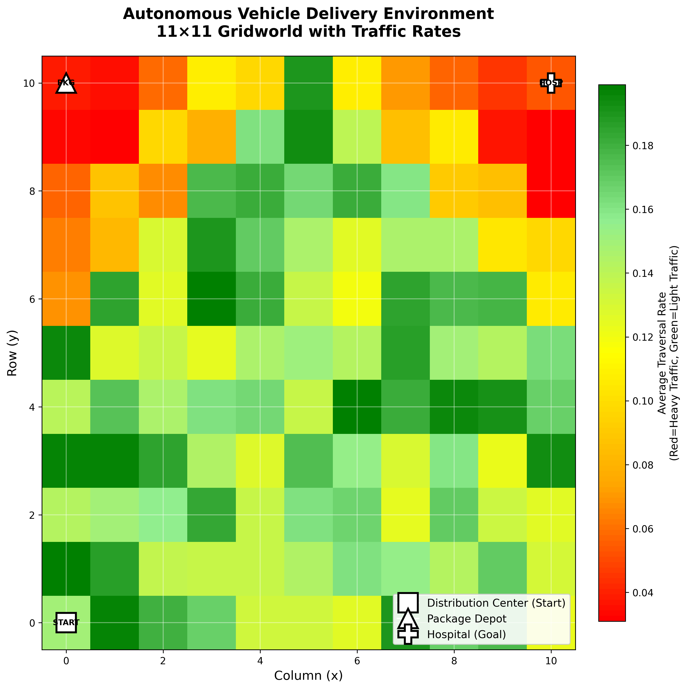
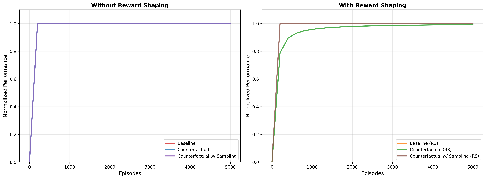

# Reproduced: Continuous-Time Reward Machines

A from-scratch Python re-implementation of **Continuous-Time Reward Machines (CTRMs)** and the learning methods proposed for them in:

> Amin Falah, Shibashis Guha, and Ashutosh Trivedi. *Continuous-Time Reward Machines.* Proceedings of the Thirty-Fourth International Joint Conference on Artificial Intelligence (IJCAI 2025). [doi:10.24963/ijcai.2025/563](https://doi.org/10.24963/ijcai.2025/563)

It covers tabular **baseline Q-learning** for continuous-time MDPs, **counterfactual-experience** Q-learning that exploits the known CTRM structure (with exact or sampled rates), **CTRM reward shaping**, and **value iteration** to compute the optimal value used as the yardstick. The methods are evaluated on an 11×11 **autonomous-vehicle delivery** gridworld modeled on the paper's benchmark, plus a smaller cop-car gridworld.

Built for the research pathway of CS 4100 *Artificial Intelligence* at Northeastern University (Spring 2026). My presentation of the paper and of these results is in [`docs/presentation.pdf`](docs/presentation.pdf).

> **Note on AI use:** Claude (an AI assistant) was used only to organize my original course files into this GitHub project. That meant restructuring the folders, pointing the plotting scripts at `results/figures/`, and writing this README. The reinforcement-learning code, experiments and presentation are my own coursework.



---

## Background

Classic reinforcement learning assumes every action takes one time step. In many real systems (traffic, logistics, emergency response) actions take a random amount of time. A **continuous-time MDP (CTMDP)** models this with an exit-rate function $\lambda(s,a)$: the time spent in state $s$ after action $a$ is exponentially distributed with rate $\lambda(s,a)$, and rewards are discounted by $e^{-\gamma t}$ in real time.

A **reward machine** is a finite automaton over high-level events that encodes a non-Markovian task (here: *pick up the package, then reach the hospital*). A **CTRM** extends it with a rate function that depends on the automaton state. For example, a vehicle carrying a medical package uses its siren and moves 10× faster. Splitting the system into a discrete-time MDP plus a CTRM lets an agent reuse rate information (such as historical traffic data) instead of learning it from scratch.

## Methods implemented

| Method | Idea | Code |
|---|---|---|
| Value iteration | Optimal value on the product of the environment and the CTRM, using the expected discount $\lambda/(\lambda+\gamma)$ of an exponential holding time | [`src/value_iteration.py`](src/value_iteration.py) |
| Baseline Q-learning | Treats the CTRM as a black box; updates with the sampled holding time $\tau$ and discount $e^{-\gamma\tau}$ | [`src/TabularLearning.py`](src/TabularLearning.py) |
| Counterfactual experience | After each real step, replays the transition from **every** CTRM state, using the known rate for each, so one step yields several updates | [`src/TabularLearningCounterFactual.py`](src/TabularLearningCounterFactual.py) |
| Counterfactual w/ sampling | Same, but the holding time is estimated by averaging 10 sampled exponential durations instead of using $1/\lambda$ directly | [`src/TabularCounterSampling.py`](src/TabularCounterSampling.py) |
| CTRM reward shaping | Potential-based shaping from a value function over CTRM states, adding $\frac{\lambda}{\lambda+\gamma}\Phi(q') - \Phi(q)$ to each reward | `getrewardshaping` / `ctrm_vi` in each learner |

Performance is measured at regular evaluation points: the learner's greedy policy is evaluated exactly on the model, divided by the optimal value from value iteration, and averaged over all evaluation points so far. A curve at **1.0 means the policy has been optimal at every evaluation**.

## Environments

- **Autonomous-vehicle delivery** (11×11 grid, actions succeed with probability 0.9). The vehicle starts at the distribution center (0, 0), must pick up a medical package at (10, 0), then deliver it to the hospital at (10, 10). The CTRM has three states: *no package* → *carrying package* → *delivered*. Traffic rates are synthetic but seeded: congested (0.03–0.06) near the depot and hospital, moderate (0.06–0.12) nearby, light (0.12–0.20) elsewhere, with a small per-direction factor. While the package is on board, rates are 10× higher. Code: [`src/AutonomousVehicleEnv.py`](src/AutonomousVehicleEnv.py), [`src/AutonomousVehicleCTRM.py`](src/AutonomousVehicleCTRM.py).
- **Cop car** (5×5 grid). The task is *reach the siren, then the thief, then return to the start*, with a four-state CTRM and a faster rate function while the siren is on. Code: [`src/CopCarEnv.py`](src/CopCarEnv.py), [`src/CopCarCTRM.py`](src/CopCarCTRM.py).

## Results

Autonomous-vehicle delivery, 5,000 episodes of up to 3,000 steps, evaluated every 200 episodes ($\gamma = 0.01$, $\alpha = 0.1$):



- **Counterfactual experience is what makes the task learnable.** Both counterfactual variants reach the optimal value (1.0) by the first evaluation at episode 200.
- **Sampled rates perform as well as exact rates.** This matches the paper's finding that counterfactual learning with sampled rates is comparable to having full rate information.
- **The baseline does not learn the task in this budget.** Its greedy policy never completes the delivery, so its normalized value stays at 0. The reward is sparse (only on delivery) and holding times near the depot and hospital are long, so the black-box learner rarely sees the reward.

Earlier 10,000-episode runs from a previous version of the experiment script show the same gap between the baseline and counterfactual learning: [baseline vs counterfactual](results/figures/baseline_vs_counterfactual.png) and [four learners](results/figures/autonomous_vehicle_performance.png). An earlier [reward-shaping plot](results/figures/reward_shaping_impact.png) shows shaping speeding up counterfactual learning, but the current scripts do not reproduce it (see *Known limitations*). [`traffic_rates_heatmap.png`](results/figures/traffic_rates_heatmap.png) shows the normal and emergency rate functions side by side.

---

## Running it

```bash
pip install -r requirements.txt
cd src
python main_autonomous_vehicle.py   # all six learners on the delivery task; writes results/figures/
python visualize_environment.py     # traffic-rate heatmaps
python main.py                      # baseline vs counterfactual on the 5x5 cop-car task
```

`main_autonomous_vehicle.py` sets `num_runs = 1` to keep runtime reasonable. Raise it to average over several seeds; the plots already shade the 25th–75th percentile band.

## Repository layout

```
├── src/
│   ├── GridWorld.py                       noisy 4-action grid dynamics, exponential holding times
│   ├── AutonomousVehicleEnv.py            delivery environment (labels: has_package, at_hospital)
│   ├── AutonomousVehicleCTRM.py           3-state CTRM with normal / emergency rate functions
│   ├── CopCarEnv.py, CopCarCTRM.py        cop-car environment and its 4-state CTRM
│   ├── value_iteration.py                 optimal value on the product MDP
│   ├── TabularLearning.py                 baseline Q-learning (+ optional reward shaping)
│   ├── TabularLearningCounterFactual.py   counterfactual-experience Q-learning
│   ├── TabularCounterSampling.py          counterfactual learning with sampled holding times
│   ├── main_autonomous_vehicle.py         delivery experiment and plots
│   ├── visualize_environment.py           rate heatmaps
│   └── main.py                            cop-car experiment
├── results/figures/                       generated plots
└── docs/presentation.pdf                  my presentation of the paper and results
```

## Known limitations

- **Reward shaping is only active in `trainwithconvergence()`.** That method computes the CTRM potential with `ctrm_vi()`. `train()`, which the experiment scripts call, never does, so the potential stays 0 and the shaping term is 0. The "(RS)" curves from `main_autonomous_vehicle.py` are therefore unshaped runs, and their small differences from the plain curves are run-to-run noise.
- **Single run per method.** With `num_runs = 1`, the 25th–75th percentile bands collapse onto the median line.
- **Heatmap axis labels are swapped.** The rate tables are indexed by (x, y), but `visualize_environment.py` plots x on the vertical axis while labeling it "Row (y)". The markers are placed consistently with the plotted data.
- **Synthetic rates.** The traffic rates are generated with a fixed seed to mimic the paper's benchmark, not taken from the paper's data, so absolute values differ from the paper's.

## Acknowledgements

The CTRM formalism, the counterfactual-experience and reward-shaping methods, and the autonomous-vehicle benchmark are from Falah, Guha and Trivedi (IJCAI 2025). This repository is my independent re-implementation for coursework.
